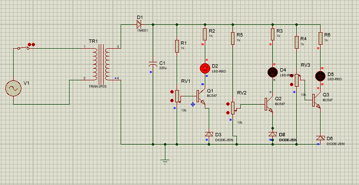
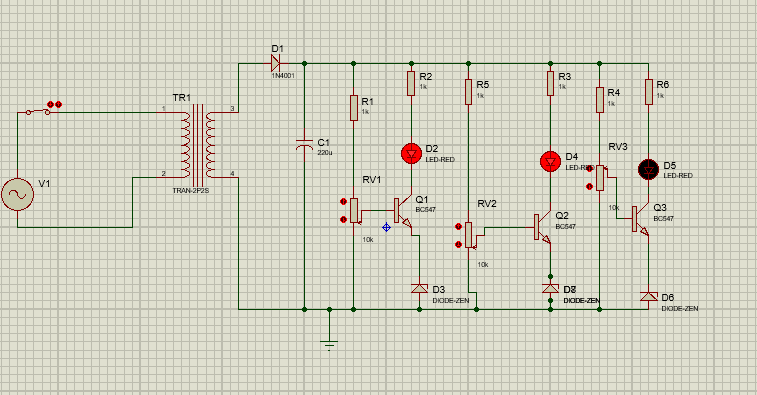
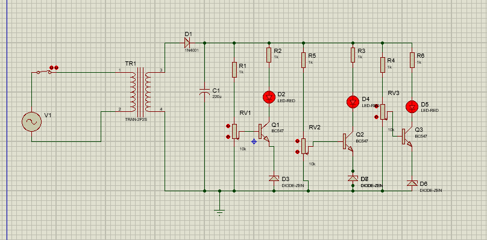
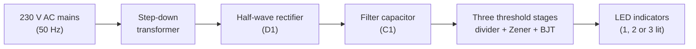

# Visual AC Mains Voltage Indicator

**Electrical Network Analysis Lab (EE-19B) · Institute of Space Technology, Islamabad**

A three-LED level indicator that shows the range of the AC mains voltage at a glance. As the mains voltage rises, more LEDs switch on. The design combines a step-down transformer, a half-wave rectifier, a capacitor filter, adjustable voltage dividers and transistor switches with Zener-diode references, and it was simulated in Proteus.

---

## Results

| Mains input | LEDs on |
|---|---|
| Below 175 V | None |
| 175 V to 200 V | 1 LED (D2) |
| 200 V to 230 V | 2 LEDs (D2, D4) |
| 240 V and above | 3 LEDs (D2, D4, D5) |

Behaviour between 230 V and 240 V is not covered by the recorded test cases.

| 175 V to 200 V (1 LED) | 200 V to 230 V (2 LEDs) | 240 V and above (3 LEDs) |
|---|---|---|
|  |  |  |

---

## How it works



**1. Step-down.** The transformer scales the mains voltage down to a low, safe level. Its secondary voltage is proportional to the primary voltage, so everything downstream tracks the mains voltage.

**2. Half-wave rectification.** The diode D1 (1N4001) conducts only on the positive half-cycle and blocks the negative half-cycle. The result is pulsating DC with a peak of about `V_peak − V_D`, where `V_peak = √2 · V_rms` and `V_D` is the diode's forward drop (about 0.7 V).

**3. Filtering.** The 220 µF capacitor C1 charges to the peak and discharges slowly into the load, which smooths the pulses into a nearly constant DC level. The remaining ripple is approximately `ΔV ≈ I_load / (f · C)`. Because a half-wave rectifier delivers only one charging pulse per cycle, its ripple is higher than that of a full-wave design.

**4. Threshold sensing.** Each of the three channels senses the filtered DC level, which rises and falls with the mains voltage:

- A 1 kΩ resistor in series with a 10 kΩ potentiometer forms an adjustable **voltage divider**. The wiper feeds the base of a BC547 transistor.
- A **Zener diode** in the emitter leg adds a reference offset, so the transistor only starts conducting once the base voltage exceeds roughly `V_Z + V_BE`.
- When the transistor turns on, current flows from the rail through a 1 kΩ resistor and the LED into the collector, and the LED lights.

**5. Staggered thresholds.** Each potentiometer is set to a different division ratio, so the three transistors turn on at successively higher mains voltages. The result is the bar-graph effect in the results table.

---

## Circuit concepts demonstrated

| Concept | Where it appears |
|---|---|
| Transformer step-down | Scales 230 V mains to a low-voltage secondary, with electrical isolation from the mains |
| Half-wave rectification | D1 converts AC to pulsating DC, accounting for the diode's forward drop |
| Capacitor filtering and ripple | C1 smooths the rectified waveform, and the ripple relation `ΔV ≈ I / (f · C)` sets the trade-off between capacitance and load |
| Voltage divider | Resistor and potentiometer pairs set each channel's trip point |
| Zener diode as a voltage reference | Sets the base voltage at which each transistor begins to conduct |
| BJT as a switch | BC547 operates between cutoff and saturation to drive each LED |
| Current limiting | 1 kΩ series resistors limit LED current; `R = (V − V_LED) / I` |
| Threshold detection | Staggered trip points turn an analog voltage into a discrete level display |

---

## Components

| Reference | Component | Value |
|---|---|---|
| V1 | AC source with switch | 230 V, 50 Hz |
| TR1 | Step-down transformer | 9 V |
| D1 | Rectifier diode | 1N4001 |
| C1 | Filter capacitor | 220 µF |
| R1, R4, R5 | Divider resistors | 1 kΩ |
| R2, R3, R6 | LED series resistors | 1 kΩ |
| RV1, RV2, RV3 | Potentiometers (threshold adjustment) | 10 kΩ |
| Q1, Q2, Q3 | NPN transistors | BC547 |
| Zener diodes | Reference diodes, one per channel | see schematic |
| D2, D4, D5 | Indicator LEDs | Red |

---

## Design notes and limitations

- **Coarse indicator, not a meter.** The trip points depend on the Zener voltage, the transistor's `V_BE` (which shifts with temperature) and the potentiometer settings, so each channel needs calibration.
- **Ripple.** Half-wave rectification leaves more ripple than a full-wave bridge, which can make the thresholds slightly less stable.
- **Simulation.** The results come from Proteus simulation.
- **Mains safety.** Mains voltage is dangerous. If you build this circuit, use an isolating transformer, an enclosure, a fuse, and proper insulation, and never probe the primary side while it is powered.

### Possible improvements

- Replace the half-wave rectifier with a full-wave bridge to reduce ripple.
- Use a precision reference such as the TL431, or a comparator or LED bar-graph driver IC, for more accurate and repeatable thresholds.
- Add more LED channels for finer voltage steps.

---

## Tools

Proteus (schematic capture and simulation)

## Repository contents

```
ac-mains-voltage-indicator/
├── README.md
└── images/
    ├── schematic_175-200V_one-led.png
    ├── schematic_200-230V_two-leds.png
    └── schematic_240V-plus_three-leds.png
```
